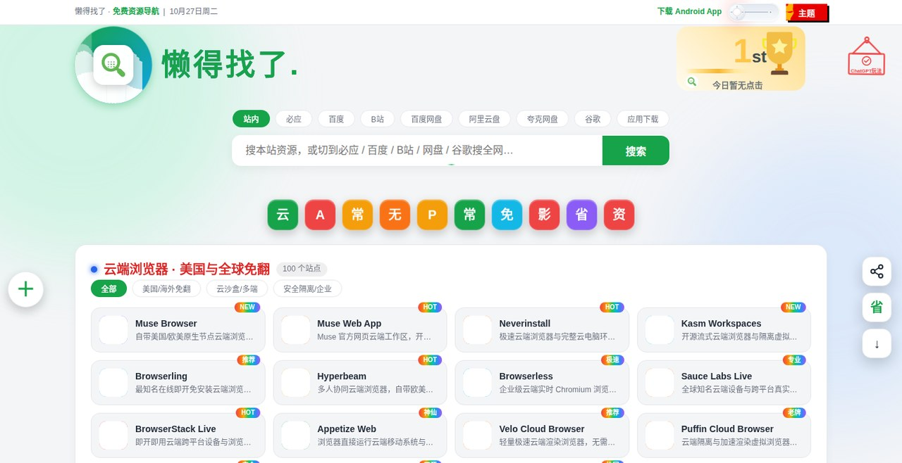
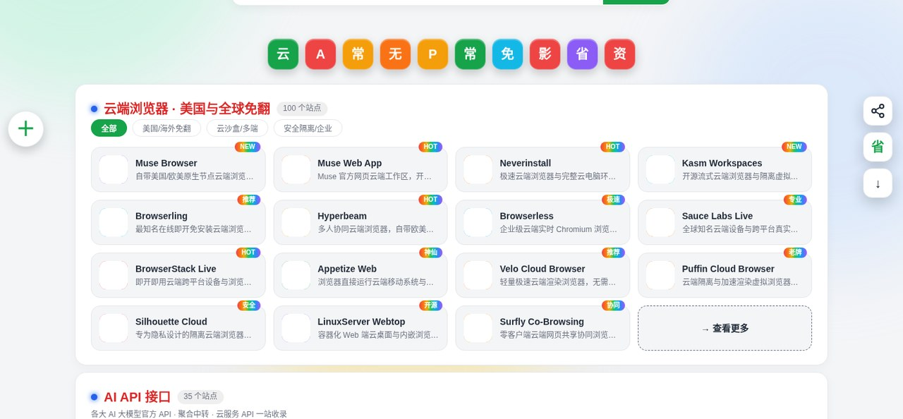
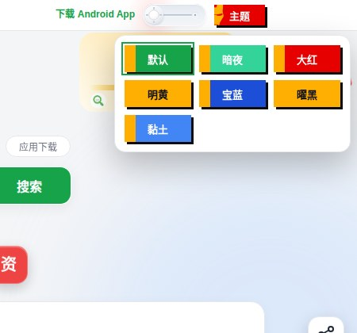
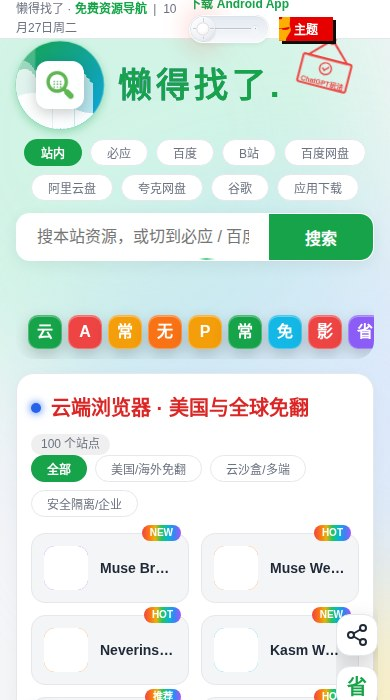

# 懒得找了 · 免费资源导航

> 找网站，懒得找了。

线上地址：https://landezhaole.pages.dev

Android App 下载：https://github.com/shuting52/10-05landezhaole/releases/latest

「懒得找了」免费资源导航站：21 大分类、2603 个精选站点，打开即用，不用安装。网站与 Android App 读取同一份 `data.json`。

## 截图



首页：Logo、搜索、排名卡、分类卡片



分类浏览：每分类首页只展示 4 行，右下角 tile 点进独立分类页看全部



主题选择：默认 / 暗夜 / 大红 / 明黄 / 宝蓝 / 曜黑 / 黏土，共 7 套



手机端：Logo、搜索、分类卡片

## 功能

- **2603 个站点，21 大分类**：分类内按子类筛选，卡片整张可点直接跳转
- **站内搜索 + 9 个搜索引擎**：站内、必应、百度、B站、百度网盘、阿里云盘、夸克网盘、谷歌、应用下载；搜应用名可在站内直接下载 APK（分段下载、进度显示，保存为“懒得找了.apk”）
- **查看更多**：每分类首页只展示 4 行，点右下角 tile 进独立分类页（`cat.html`）看该分类全部站点
- **今日点击与排名卡**：卡片悬停显示本设备今日点击次数；首页右上角排名卡显示今日点击第一名与本站收录总数（仅本设备统计，不上传）
- **7 套主题**：默认、暗夜、大红、明黄、宝蓝、曜黑、黏土；夜间开关与主题偏好保存在浏览器本地
- **启动页**：LDZ 描边动画 + “懒得找了”，3.5 秒后淡出，点一下可跳过（仅首页）
- **ChatGPT 玩法**：右上角灯泡进入，89 类 703 条做图指令，分类筛选 + 搜索，点卡片复制玩法说明
- **省钱小助手**：22 张优惠券卡（吃喝餐饮 / 旅游出行 / 生活服务），悬停显示二维码（`sq.html`）
- **左侧悬浮菜单**：点 + 展开 5 个入口：关于网站、微信打赏、QQ 好友、支付宝打赏、最新 Q 群
- **右侧悬浮工具栏**：回到顶部、分享、省钱小助手、直达底部；上下两个按钮只在滚动时呈现（顶部时 ↑ 隐藏、到底时 ↓ 隐藏）
- **卡片角标**：右上角七彩角标（HOT / NEW / 推荐 / 精选）；新站点打 NEW 标签时，右上角弹一次上新汇总提醒，点提醒直达新站点
- **卡片图标**：站点真实图标，多源兜底（Google → 站点 apple-touch-icon → favicon.ico），部分站点配有验证过的官方图标地址

## 目录

```
index.html            网站本体（页面 + 样式 + 脚本）
data.json             站点数据（21 分类、2603 条）
cat.html              独立分类页（查看更多进入）
chatgpt.html          ChatGPT 玩法页
chatgpt-prompts.json  玩法数据（89 类 703 条）
sq.html / sq/         省钱小助手页及素材
icons/                品牌图标（微信 / QQ / 支付宝等）
icon.png / favicon.png  网站图标
version.json          网站版本号与版本记录（仅记录，不再弹窗）
README.md             本文件
docs/screenshots/    本文件配图
android/              Android App 工程（Kotlin + Jetpack Compose 原生）
dist/                 App 发版产物与版本信息
```

## 本地预览

本仓库是纯静态站，不需要构建，直接用任意静态服务器打开根目录即可，例如：

```bash
python3 -m http.server 8000
# 打开 http://localhost:8000
```

> 注意：直接用 `file://` 打开时，`data.json` / `version.json` 可能因浏览器安全策略读不到，请用上面的本地服务器方式。

## 部署到 Cloudflare Pages

1. 在 Cloudflare Pages 新建项目，上传本仓库根目录文件（或连接本仓库，构建命令留空，输出目录填根目录）。
2. 部署完成后访问分配的 `*.pages.dev` 域名；如需自定义域名，在 Pages 项目里绑定已接入 Cloudflare 的域名即可。

本站当前生产域名 `landezhaole.pages.dev` 即按此方式部署。

## 版本记录

网站不再弹更新日志弹窗，`version.json` 只作版本记录。发新版：

1. 改 `version.json`：`version` +1，更新 `date`，在 `changes` 里写清本次改动；上一版的 `changes` 移到 `history` 顶部。
2. 如有站点变动，同步更新 `data.json`（新站点请打上 `NEW` 标签，才会触发上新提醒）。
3. 重新部署到 Pages。

## 数据说明

`data.json` 是网站的数据集，卡片字段：

- `t` 标题、`u` 链接、`d` 简介、`b` 角标（HOT / NEW）、`s` 子类、`f` 兜底字母
- `i` 验证过的图标地址（可选；有它时优先用它，失败时仍走多源兜底）

## Android App

同仓库 `android/`（Kotlin + Jetpack Compose 原生）：首页 / 分类 / 省钱小助手 / 我的 4 个 Tab，多套主题，站点数据与网站同源（启动时从云端拉取，无网络时首次打开站点列表为空）。

下载见顶栏链接（10-05landezhaole releases/latest）。

## 声明

本站为免费资源导航，所有外链归原站所有；图标为各站点公开 favicon 或官方 logo，链接失效欢迎反馈。
